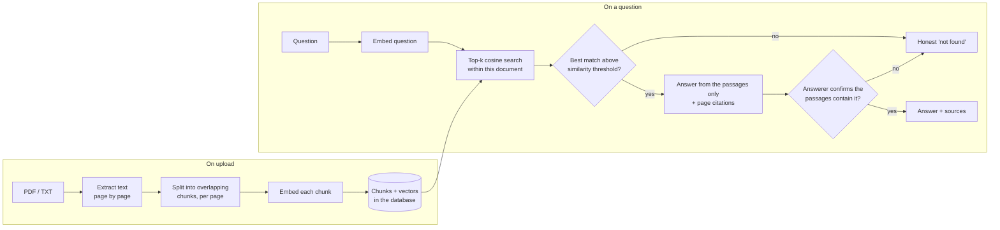

# Document Q&A API (RAG)

Upload a PDF or text file, then ask questions about it in plain English. The API answers **only from your document**, cites the page and passage each answer came from, and says so honestly when the document doesn't contain the answer.

Built with **FastAPI**, **SQLAlchemy** and **PostgreSQL**, with a retrieval-augmented generation (RAG) pipeline written from scratch: text extraction, chunking, embeddings, vector search and grounded answer generation.

- **Web app (no coding needed):** https://document-qa-api-jhim.onrender.com
- **Interactive API docs (for developers):** https://document-qa-api-jhim.onrender.com/docs
- **Run the guided demo against it:** `python scripts/demo.py https://document-qa-api-jhim.onrender.com`

> Free hosting: the first request after 15 idle minutes can take up to a minute while the server wakes up.

## Example

```http
POST /documents/1/ask
{ "question": "How many paid leaves do I get?", "top_k": 1 }
```

```json
{
  "question": "How many paid leaves do I get?",
  "answer": "Full-time employees receive 18 days of paid leave per calendar year, credited at 1.5 days per month. (p. 2)",
  "found": true,
  "sources": [
    { "chunk_id": 2, "page": 2, "score": 0.2962, "text": "2. Leave Policy: Full-time employees receive 18 days of paid leave per calendar year, credited at 1.5 days per month. Up to 10 unused paid leave days can be carried forward ..." }
  ],
  "answered_by": "extractive"
}
```

Ask something the document doesn't cover, and it refuses instead of guessing:

```json
{
  "question": "What is the company's stock price?",
  "answer": "I couldn't find the answer to that in this document.",
  "found": false,
  "sources": [],
  "answered_by": "similarity-threshold"
}
```

## Try it in 2 minutes

**Windows:** double-click [`run-local.bat`](run-local.bat). It creates a virtual environment, installs the dependencies, starts the API in its own window, runs a guided demo, and opens the interactive docs at http://127.0.0.1:8000/docs.

**macOS / Linux:**

```bash
python -m venv .venv && source .venv/bin/activate
pip install -r requirements.txt
uvicorn app.main:app &          # start the API
python scripts/demo.py          # guided end-to-end demo
```

The demo signs up a user, uploads the sample PDF, asks questions and checks privacy. Output (trimmed):

```text
== 3. Upload the sample PDF ==
Indexed 'lumenbay-hr-policy.pdf': 4 pages -> 4 searchable chunks.

== 4. Ask questions ==
Q: How many paid leaves do I get?
FOUND     Full-time employees receive 18 days of paid leave per calendar year, credited at 1.5 days
          per month. (p. 2)
          source: page 2, similarity 0.30

Q: What is the company's stock price?
NOT FOUND I couldn't find the answer to that in this document.

== 5. Privacy check: a second user tries to read the document ==
Second user gets HTTP 404 (expected 404: they can't even tell it exists).
```

Point it at a deployed copy with `python scripts/demo.py https://<your-service>.onrender.com`.

## How it works



**Two layers of hallucination protection.** First, if even the closest passage is far from the question, the API refuses without calling a model at all, which also saves LLM costs. Second, the answerer must confirm that the passages contain the answer: the LLM is told to reply `NOT_FOUND` otherwise, and the offline answerer requires the passage to cover the question's key terms.

## Features

- **A web app for non-technical users** at `/`: one-click sample document, drag-and-drop upload, suggested questions, and answers that show their page, the sentence they came from (shaded green) and the matching words (highlighted). A private guest session is created automatically, with no sign-up.
- Upload PDF, `.txt` or `.md` (up to 10 MB). Text is extracted per page so every answer cites a page.
- Overlapping, page-aware chunking, so facts on a chunk boundary aren't lost and chunks never mix pages.
- Pluggable embeddings and answer generation (see [AI providers](#ai-providers)). It **runs fully offline by default**, with no API key.
- Works with any **OpenAI-compatible** provider: OpenAI, Groq, Google Gemini, or a local Ollama model.
- JWT authentication. Every document, question and deletion is scoped to its owner: other users' documents return `404`.
- Deleting a document deletes all of its chunks and vectors (cascading delete).
- Guards against prompt injection: document text is passed to the LLM as delimited, untrusted content it must not obey.
- Detects when the embedding model has changed since a document was indexed, and asks for a re-upload instead of returning meaningless results.
- 62 automated tests, including a mocked LLM, so the suite needs no network or keys.

## API endpoints

| Method | Path | Purpose | Auth |
|---|---|---|---|
| POST | `/auth/signup` | Create an account | No |
| POST | `/auth/login` | Get a JWT token | No |
| GET | `/auth/me` | Show the logged-in account | Yes |
| POST | `/documents` | Upload a document (multipart `file`); it's indexed before the response returns | Yes |
| GET | `/documents` | List my documents | Yes |
| GET | `/documents/{id}` | One of my documents | Yes |
| POST | `/documents/{id}/ask` | Ask a question: `{"question": "...", "top_k": 4}` | Yes |
| DELETE | `/documents/{id}` | Delete a document and its vectors | Yes |
| GET | `/health` | Health check, including which AI providers are active | No |

## AI providers

| Setting | Default (offline) | With an API key |
|---|---|---|
| Embeddings | `hash`: hashing-trick bag of words (unigrams + bigrams). Matches shared words, not synonyms. | `EMBEDDINGS_PROVIDER=openai`: semantic embeddings from any OpenAI-compatible `/embeddings` API |
| Answers | `extractive`: quotes the best-matching sentence with its page | `LLM_PROVIDER=openai`: an LLM writes a concise answer from the retrieved passages, with citations |

Set these in `.env` (see [`.env.example`](.env.example)). Examples of `LLM_BASE_URL`:

| Provider | `LLM_BASE_URL` |
|---|---|
| OpenAI | `https://api.openai.com/v1` |
| Groq | `https://api.groq.com/openai/v1` |
| Google Gemini | `https://generativelanguage.googleapis.com/v1beta/openai/` |
| Ollama (local, free) | `http://localhost:11434/v1` |

Set `LLM_MODEL` to a model your provider currently offers (check its docs). After changing the embeddings provider, re-upload your documents.

## Run locally

```bash
python -m venv .venv
source .venv/bin/activate        # Windows: .venv\Scripts\activate
pip install -r requirements.txt
cp .env.example .env             # Windows: copy .env.example .env
uvicorn app.main:app --reload
```

Open http://127.0.0.1:8000 for the web app. For the API itself, open http://127.0.0.1:8000/docs, sign up, log in, click **Authorize**, then upload [`sample_docs/lumenbay-hr-policy.pdf`](sample_docs/lumenbay-hr-policy.pdf), a fictional 4-page HR policy. Try:

- *How many paid leaves do I get?*
- *What is the notice period during probation?*
- *How much health insurance cover do employees have?*
- *Is internet reimbursed?*
- *What is the company's stock price?* (not in the document, so it refuses)

### Using curl

```bash
BASE=http://127.0.0.1:8000
curl -X POST $BASE/auth/signup -H "Content-Type: application/json" -d '{"email":"arjun@example.com","password":"secret123"}'
TOKEN=$(curl -s -X POST $BASE/auth/login -d "username=arjun@example.com&password=secret123" | python -c "import sys,json;print(json.load(sys.stdin)['access_token'])")

curl -X POST $BASE/documents -H "Authorization: Bearer $TOKEN" -F "file=@sample_docs/lumenbay-hr-policy.pdf"
curl -X POST $BASE/documents/1/ask -H "Authorization: Bearer $TOKEN" -H "Content-Type: application/json" \
     -d '{"question":"How many paid leaves do I get?"}'
```

## Run the tests

```bash
pytest
```

The suite uses an in-memory database and the offline providers. LLM and embedding API calls are tested against a mocked HTTP transport.

## Design decisions

- **Vectors live in the main database** (as `float32` bytes beside each chunk) instead of a separate vector database. A question searches one document, so ranking a few hundred vectors with one NumPy matrix product is instant, and there's one less service to deploy. The search function is isolated in `app/rag/store.py`, so it can move to pgvector, Chroma or FAISS when one search must span thousands of documents.
- **Chunks never cross pages.** That trades a little context for an exact page number on every citation.
- **The similarity gate runs before the LLM.** Clearly irrelevant questions never cost a model call.
- **Providers are injected as FastAPI dependencies.** Routes don't know which embedder or LLM is active, and tests swap in fakes with `app.dependency_overrides`.
- **Indexing is synchronous.** Simple and fine for documents of a few dozen pages; a background job queue is listed under future work.

## Project structure

```
app/
  main.py               app entry point, routers, web app at /, /health
  web/index.html        the web app (one self-contained page, no build step)
  config.py             settings from environment variables
  database.py           engine, sessions, get_db
  models.py             users, documents, chunks (with embeddings)
  schemas.py            request/response shapes
  security.py, deps.py  bcrypt + JWT, get_current_user guard
  routers/
    auth.py             /auth/signup, /auth/login, /auth/me
    documents.py        upload, list, get, ask, delete
  rag/
    extract.py          PDF/text -> clean text per page
    chunking.py         page-aware overlapping chunks
    text.py             tokenising, stemming, sentence splitting
    embeddings.py       hash + OpenAI-compatible embedders
    store.py            vector storage and cosine search
    answer.py           extractive + OpenAI-compatible LLM answerers, grounding prompt
    providers.py        builds the configured providers (FastAPI dependencies)
    pipeline.py         index_document, answer_question
tests/                  62 pytest tests
sample_docs/            fictional demo PDF
scripts/                demo.py (guided end-to-end demo), make_sample_pdf.py
run-local.bat           one-click local demo on Windows
```

## Deploy to Render

Render allows one free PostgreSQL database per workspace, so this API shares the `portfolio-db` database created by the [Expense Tracker API](https://github.com/SAK522/expense-tracker-api) Blueprint. Each app keeps its tables in its own schema (`DATABASE_SCHEMA=docqa` here), so they never mix.

1. Deploy the Expense Tracker API Blueprint first (it creates `portfolio-db`), or create any PostgreSQL database.
2. In Render: **New → Blueprint**, then select this repository.
3. When asked for `DATABASE_URL`, paste the database's **Internal Database URL** (Render dashboard → `portfolio-db` → **Connect** → **Internal**).
4. Wait for the build, then open `https://<your-service>.onrender.com/docs`, or run `python scripts/demo.py https://<your-service>.onrender.com`.
5. Optional: to use a real LLM, set `LLM_PROVIDER=openai`, `LLM_API_KEY`, `LLM_BASE_URL` and `LLM_MODEL` in the service's environment settings.

Free services sleep after 15 minutes without traffic and take up to a minute to wake, and free Render PostgreSQL databases expire 30 days after creation, so check Render's current free-tier terms.

## Future work

- Background indexing (job queue) with a document status field
- OCR for scanned PDFs
- Questions across multiple documents, and chat memory for follow-up questions
- Hybrid search (keyword + semantic) and re-ranking
- pgvector index for large collections
- Streaming answers
